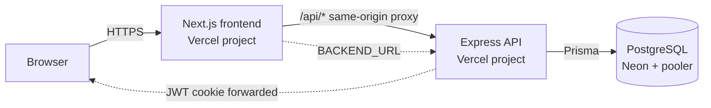

# Calendar Project

A full-stack calendar application for planning events, shaping your week, and
managing your account. The frontend is a **Next.js 16** App Router app; the
backend is an **Express 5 + Prisma 6** API backed by **PostgreSQL**. Both are
designed to run as two separate **Vercel** projects.

---

## Features

- **Accounts and sessions** — email/password signup, login, logout, and a
  seven-day JWT session stored in an `HttpOnly` cookie.
- **Calendar events** — create, edit, and delete events with a title,
  description, date, optional start/end time, all-day support, and five colors.
- **Multiple views** — month grid, current-week strip, selected-day agenda, and
  an "upcoming" list that all share the same data.
- **Safe deletes** — delete from the event detail modal or the month-grid
  popover, both with a two-step confirmation.
- **Real settings** — first name, last name, bio, date of birth, email, password
  change, week-start preference (Monday or Sunday), and a default event
  duration (5–240 minutes).
- **Preferences that apply** — week start and default duration drive the week
  strip, month grid, and new-event form.
- **Theme support** — light and dark mode using semantic design tokens.
- **Responsive, accessible UI** — BoardUI source components, React Aria
  primitives, keyboard-friendly dialogs and focus states.
- **Public landing page** — scroll-aware header and a centered hero with a
  framed product screenshot, **Sign up** (`/signup`) and **Log in** (`/login`)
  calls to action, and a short capability strip.

---

## Architecture



The browser only talks to the frontend origin. The frontend's
`/api/[...path]` Route Handler forwards requests to `BACKEND_URL` and forwards
`Set-Cookie` back to the browser. That keeps the session cookie **first-party**,
which avoids cross-site cookie problems and means `SameSite=Lax` is sufficient
in production.

| App | Directory | Vercel root | Responsibility |
| --- | --- | --- | --- |
| Frontend | `frontend/` | `frontend` | UI, routing, prerendering, `/api` proxy |
| Backend | `backend/` | `backend` | Auth, validation, event logic, database access |

More detail:

- [Load balancing and scaling](docs/load-balancing.md) — how traffic is
  distributed today, why the API is stateless, and the database pool strategy.
- [Caching](docs/caching.md) — the event-window cache, invalidation, HTTP cache
  headers, and how coherence changes with multiple instances.
- [Authentication API](docs/README.md) — endpoint contract, cookie design, and
  hardening notes.

---

## Tech stack

| Layer | Technology |
| --- | --- |
| Frontend framework | Next.js `16.4.3` (App Router, `cacheComponents`, partial prefetching) |
| UI | React `19.3`, Tailwind CSS v4, BoardUI source components, React Aria Components |
| Icons and motion | `lucide-react`, `motion` |
| Backend | Node.js 20+, Express `5`, Zod validation |
| Data | Prisma `6`, PostgreSQL (Neon in production) |
| Auth | `jsonwebtoken`, `bcryptjs` (cost 12), `HttpOnly` cookie |
| Hosting | Vercel (two projects) + a hosted PostgreSQL database |

---

## Repository structure

```text
Calendar-project/
├── backend/
│   ├── api/index.js              # Vercel Function entry point
│   ├── prisma/
│   │   ├── schema.prisma         # User, Account, Event models
│   │   └── migrations/
│   ├── src/
│   │   ├── lib/                  # Prisma client, session helpers, TTL cache
│   │   ├── middleware/           # requireAuth
│   │   ├── routes/               # auth.js, events.js
│   │   ├── loadbalancer.js       # optional local round-robin proxy
│   │   └── server.js             # Express app + local listener
│   ├── scripts/start-cluster.mjs # spawns N API instances + balancer
│   └── vercel.json               # Prisma engine bundling
├── frontend/
│   ├── app/
│   │   ├── api/[...path]/        # same-origin backend proxy
│   │   ├── dashboard/            # signed-in app
│   │   ├── login/ signup/        # auth pages
│   │   └── page.tsx              # public landing page
│   ├── components/
│   │   ├── application/          # dashboard, settings, auth, theme
│   │   ├── base/                 # buttons, inputs, badges, ...
│   │   ├── foundations/          # direction provider
│   │   └── landing/              # hero section and landing header
│   └── lib/api.ts                # typed API client
└── docs/                         # API, design, deployment, and scaling docs
```

---

## Getting started

### Prerequisites

- Node.js **20 or newer**
- npm
- A PostgreSQL database (Neon, Supabase, or a local PostgreSQL instance)

### 1. Clone and install

```bash
git clone <repository-url>
cd Calendar-project
```

### 2. Backend

```bash
cd backend
npm install
```

Create `backend/.env`:

| Variable | Required | Description |
| --- | --- | --- |
| `DATABASE_URL` | Yes | Runtime PostgreSQL URL. Prefer the **pooled** host. |
| `DIRECT_URL` | Yes | Direct, non-pooled URL used by Prisma migrations. |
| `JWT_SECRET` | Yes | Long random string used to sign session JWTs. |
| `FRONTEND_URL` | Yes | Exact frontend origin for credentialed CORS, e.g. `http://localhost:3000`. |
| `PORT` | No | API port, default `3001`. |
| `EVENTS_CACHE_TTL_MS` | No | Event-window cache TTL in ms, default `5000`. Set `0` to disable caching. |
| `EVENTS_CACHE_MAX_ENTRIES` | No | Cached windows per API instance, default `500`. |
| `CROSS_SITE_COOKIES` | No | Set to `true` only when the browser calls the API cross-site directly. |

Apply migrations and start the API:

```bash
npm run db:deploy   # prisma migrate deploy
npm run dev         # http://localhost:3001
```

Verify:

```bash
curl http://localhost:3001/health
# {"ok":true}
```

### 3. Frontend

```bash
cd frontend
npm install
```

Create `frontend/.env`:

| Variable | Required | Description |
| --- | --- | --- |
| `BACKEND_URL` | Yes (production and local proxy) | Backend origin, e.g. `http://localhost:3001`. |
| `NEXT_PUBLIC_API_URL` | No | Legacy/direct API base. The app calls `/api` and relies on the proxy. |

Start the app:

```bash
npm run dev         # http://localhost:3000
```

Open [http://localhost:3000](http://localhost:3000), sign up, and the dashboard
is available at `/dashboard`.

> **Local note:** `BACKEND_URL` must be set for the `/api` proxy to work. Without
> it, API calls return `500 {"error":"BACKEND_URL not configured"}`.
>
> **Landing screenshot:** add the product screenshot at
> `frontend/public/hero-app.png` (roughly 1600×1000). Until that file exists the
> hero frame shows a quiet placeholder instead of a broken image.

### 4. Optional: run with a load balancer

To run several API instances behind a small round-robin balancer:

```bash
cd backend
npm run cluster        # 3 APIs on 3001–3003 + balancer on 8080
```

Then set `BACKEND_URL="http://localhost:8080"` in `frontend/.env` and restart
the frontend. The balancer checks each instance's `/health`, skips unhealthy
ones, and exposes status at `/__lb/upstreams`.

See [docs/load-balancer.md](docs/load-balancer.md) for configuration, failover
testing, and limitations. This is optional: Vercel already load-balances the
deployed app.

---

## Scripts

### Backend (`backend/`)

| Script | What it does |
| --- | --- |
| `npm run dev` | Starts Express with `node --watch` on `PORT` (default `3001`). |
| `npm start` | Starts Express without watch mode. |
| `npm run lb` | Starts the optional local load balancer on `8080`. |
| `npm run cluster` | Spawns 3 API instances and the balancer together. |
| `npm run postinstall` | Runs `prisma generate` (also runs on install). |
| `npm run db:deploy` | Applies pending Prisma migrations. |
| `npm run studio` | Opens Prisma Studio. |

### Frontend (`frontend/`)

| Script | What it does |
| --- | --- |
| `npm run dev` | Starts the Next.js dev server on `3000`. |
| `npm run build` | Builds the production bundle and prerenders static pages. |
| `npm run start` | Serves the production build. |
| `npm run lint` | Runs ESLint. |

---

## API overview

All routes are JSON. Authenticated routes use the `token` session cookie and are
scoped to the signed-in user.

### Auth

| Method | Route | Purpose |
| --- | --- | --- |
| `POST` | `/auth/signup` | Create an account and start a session. |
| `POST` | `/auth/login` | Verify credentials and start a session. |
| `GET` | `/auth/me` | Return the public current-user profile. |
| `PATCH` | `/auth/me` | Update profile fields, email, or calendar preferences. |
| `PATCH` | `/auth/password` | Change the password and keep the session. |
| `POST` | `/auth/logout` | Clear the session cookie. |

### Events

| Method | Route | Purpose |
| --- | --- | --- |
| `GET` | `/events?from=YYYY-MM-DD&to=YYYY-MM-DD` | List the user's events in a date range. |
| `POST` | `/events` | Create an event. |
| `PUT` | `/events/:id` | Replace an event owned by the user. |
| `DELETE` | `/events/:id` | Delete an event owned by the user (`204`). |

Full request/response shapes, validation rules, and status codes are documented
in [docs/README.md](docs/README.md). The delete flow works like this:

- **Detail modal:** `Delete` → confirm → `Delete event`.
- **Month popover:** `Delete` → confirm → `Delete event`.
- **API:** `DELETE /events/:id` returns `404` when the event is missing or owned
  by someone else, and `204` on success.
- **State:** a successful delete removes the event from the list, closes the
  dialog/popover, and refreshes the dashboard counts.

---

## Data model

```prisma
User   id, email (unique), passwordHash, firstName, lastName, bio,
       dateOfBirth, weekStartsOn, defaultEventDuration, createdAt
Account provider, providerAccountId, userId          // future OAuth identities
Event  id, title, description, date, startTime, endTime, allDay,
       color, userId, createdAt, updatedAt
```

Every event query includes `userId`, and `Event` has an index on
`(userId, date)` for the calendar's date-window reads. Deleting a user cascades
to their accounts and events.

---

## Deployment

Deploy two Vercel projects from the same repository:

1. **Backend** — root directory `backend`.
   - `backend/vercel.json` runs `prisma generate` and bundles the Prisma engines.
   - Set `DATABASE_URL`, `DIRECT_URL`, `JWT_SECRET`, and `FRONTEND_URL`.
   - Run migrations explicitly with `npm run db:deploy`. They are **not** part of
     the build, so a database outage cannot block a deploy.
2. **Frontend** — root directory `frontend`.
   - Set `BACKEND_URL` to the backend origin.
   - The `/api` proxy keeps the session cookie first-party.
   - Redeploy after changing `BACKEND_URL`.

Smoke test after deploying:

```bash
curl https://your-backend.vercel.app/health
# {"ok":true}
```

For capacity planning, regions, connection pooling, and failure modes, see
[docs/load-balancing.md](docs/load-balancing.md).

---

## Documentation

| Document | Contents |
| --- | --- |
| [docs/load-balancing.md](docs/load-balancing.md) | Project-specific traffic distribution, stateless API, database pooling, scaling phases, load testing. |
| [docs/load-balancer.md](docs/load-balancer.md) | Optional local load balancer: quick start, configuration, failover, limitations. |
| [docs/caching.md](docs/caching.md) | Event-window cache, keys and TTL, invalidation, HTTP headers, multi-instance coherence, verification. |
| [docs/README.md](docs/README.md) | Authentication API contract, cookie/session design, production hardening checklist. |
| [System design index](docs/Calendar%203d71e9fd7296801c921ffbbd18046765.md) | Entry point to the numbered system-design documents. |
| [System architecture](docs/03_System_Architecture.md) | Layers, connections, and data flow. |
| [API design](docs/06_API%20Design%203dd1e9fd7296801dab0cd79a8e67f607.md) | Endpoint design notes. |
| [Database design](docs/07_Database%20Design%203dd1e9fd729680f4a1ebe46a0cf6d012.md) | Schema and data considerations. |
| [Caching](docs/08_Caching%203dd1e9fd72968031bd66d7190fed4dcb.md) | Original caching design notes and MVP decision. |
| [Scalability strategy](docs/10_Scalability%20Strategy%203dd1e9fd72968050b1ddd2f4e5df57a6.md) | Phased scaling approach. |
| [Security architecture](docs/12_Security%20Architecture%203e81e9fd729680a29628f7c461243308.md) | Security model and controls. |
| [Testing strategy](docs/16_Testing%20Strategy%203e81e9fd729680b2acffd40875c4c9f3.md) | Test layers and coverage goals. |

---

## Verification

Before merging a change:

```bash
# Frontend
cd frontend
npx tsc --noEmit
npm run build

# Backend syntax check
cd ../backend
node --check src/server.js
```

The delete-event flow has been verified end to end:

- create → delete → `204`; the event is absent from the next list request;
- another user receives `404`; a repeat delete returns `404`;
- unauthenticated delete returns `401`;
- both UI entry points remove the event and refresh dashboard counts.

The event cache has been verified:

- first range read returns `X-Cache: MISS`, the immediate repeat returns `HIT`;
- create, update, and delete each invalidate that user's windows, so the next
  read is `MISS` and reflects the write;
- a second user reading the same range gets their own `MISS` and never the first
  user's data;
- `EVENTS_CACHE_TTL_MS=0` disables storage, so every read is a `MISS`.

---

## Troubleshooting

| Symptom | Likely cause | Fix |
| --- | --- | --- |
| `BACKEND_URL not configured` | Frontend env missing the backend origin | Set `BACKEND_URL` and restart/redeploy the frontend. |
| Login succeeds then immediately redirects | Cookie is not first-party or CORS rejects the origin | Use the `/api` proxy, and set the backend `FRONTEND_URL` to the exact frontend origin. |
| `npm start` in `backend/` exits without listening | `VERCEL` is set to a truthy value in the environment | The server only skips its listener when `VERCEL=1` (the real Vercel runtime). Unset it locally. |
| Prisma engine error on Vercel | Missing engine binary for the runtime | `backend/prisma/schema.prisma` includes `rhel-openssl-3.0.x`; keep it in `binaryTargets`. |
| Migrations fail through the pooler | DDL needs a direct connection | Run `npm run db:deploy` with `DIRECT_URL` pointing at the direct host. |
| Slow first API request after idle | Serverless cold start | Expected; keep the bundle lean and co-locate regions. |

---

## Roadmap

The current MVP covers the Calendar module. Planned or possible next steps:

- Task management and booking/availability modules.
- A future mobile client using the same API.
- Rate limiting backed by a shared store.
- Read replicas and multi-region failover if traffic requires it.

See the [system design index](docs/Calendar%203d71e9fd7296801c921ffbbd18046765.md)
for the full design set.
