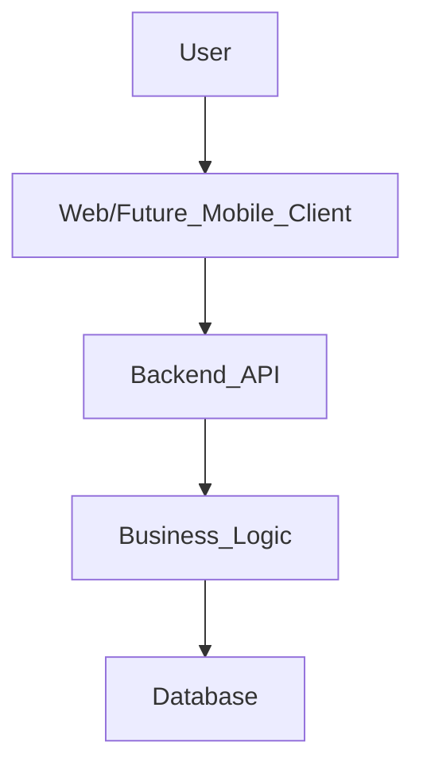
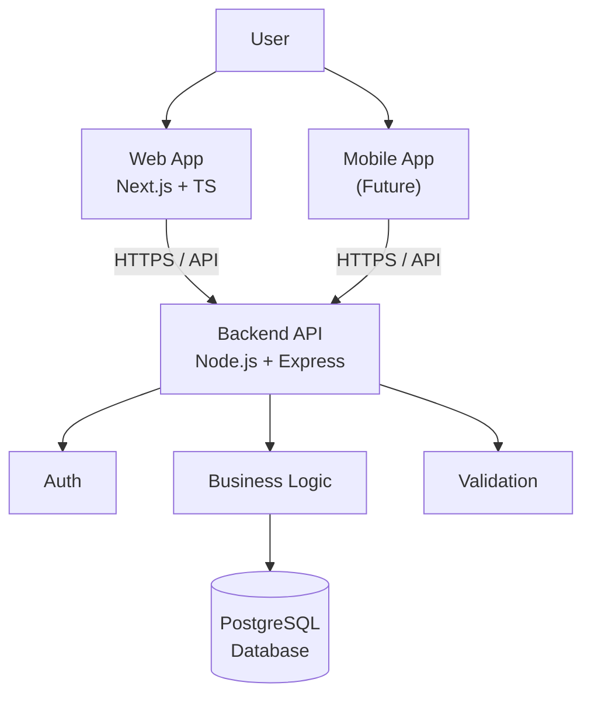
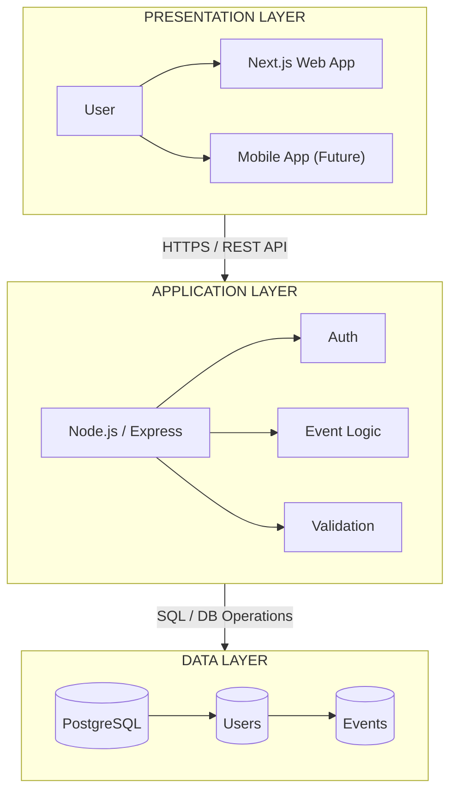
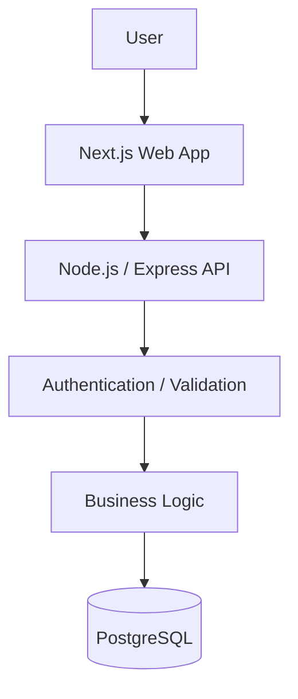
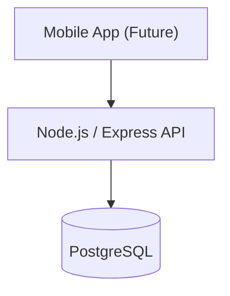
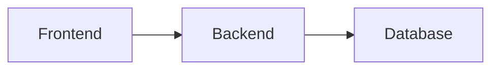
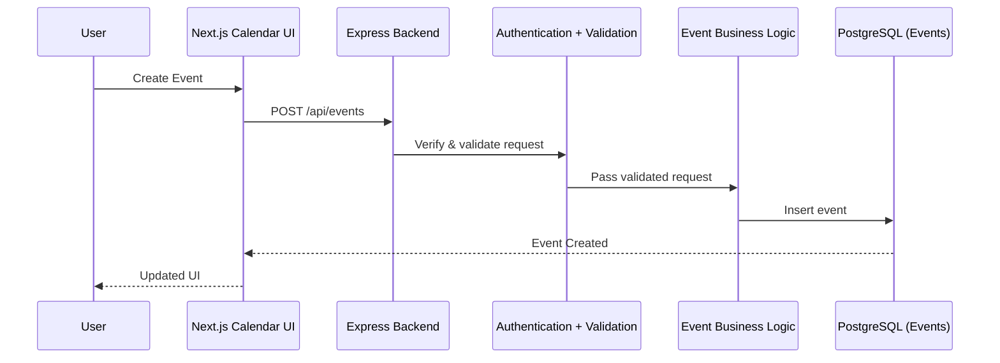
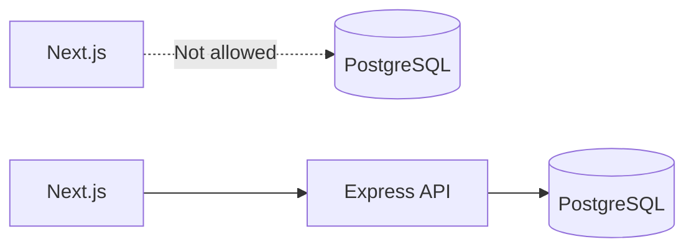
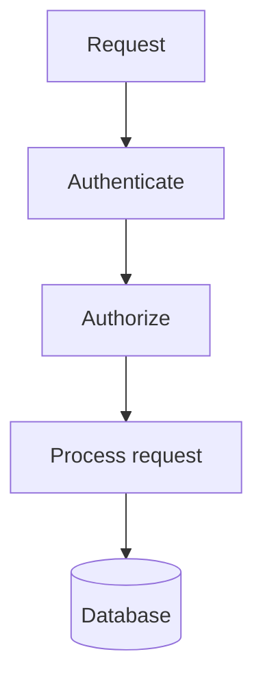
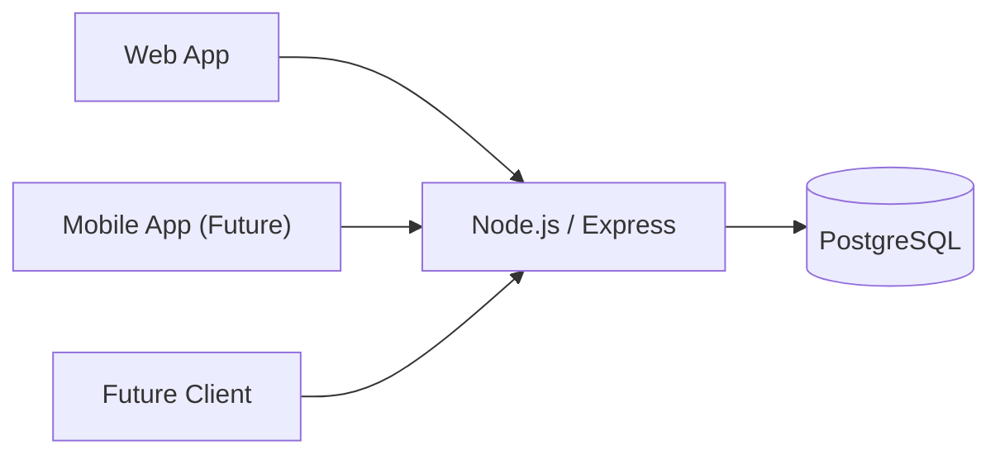

# 03_System_Architecture

## 3.1 Architecture Objective

The system architecture describes how information moves through the Calendar Ecosystem from the user interface to the backend and database.

The first architecture deliverable should therefore be a high-level flow diagram showing:

---

## 3.2 High-Level System Architecture

> **Important**
The Mobile App box is shown for the architecture to model the interaction between mobile/web applications, backend servers and the database.
> 
> 
> It is not part of the current MVP implementation. The BRS explicitly lists the mobile application as out of scope.
> 

---

## 3.3 Diagram

**Layer 1 — Client**

1. User
2. Web Application — Next.js + TypeScript
3. Mobile Application — Future

**Layer 2 — Backend**

1. Backend API — Node.js + Express
2. Authentication
3. Business Logic
4. Validation

**Layer 3 — Database**

1. PostgreSQL
2. Users
3. Events

---

## 3.4 Connections

Use arrows in this direction:

And for the future mobile client:

**Do not connect the frontend directly to PostgreSQL.**

The intended architecture is:

---

## 3.5 Example Data Flow — Creating an Event

This is a useful second diagram underneath the main architecture diagram.

---

## 3.6 Architecture Principles

### Principle 1 — No direct database access from frontend

### Principle 2 — Authentication before protected data

### Principle 3 — Backend owns business logic

The frontend should handle presentation and user interaction.

The backend should handle:

- Authentication
- Validation
- Business rules
- Database operations

### Principle 4 — Future clients use the same API

A future mobile application should be able to communicate with the same backend API rather than creating a separate backend.

