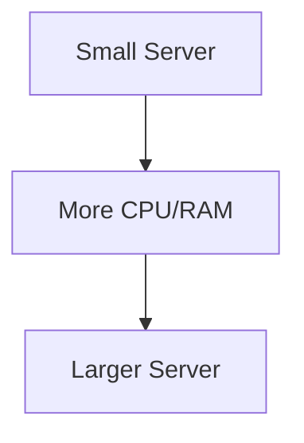
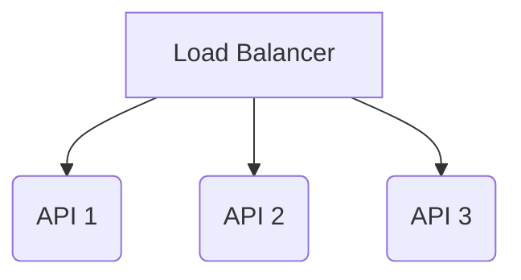
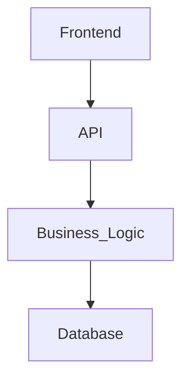

# 04_System_Design_Fundamentals

## Purpose

This section defines the core system-design principles that guide the Calendar Ecosystem architecture.

The objective is to ensure the system is:

- Scalable
- Reliable
- Maintainable
- Secure
- Performant
- Modular

## Scalability

Scalability refers to the system's ability to handle increasing numbers of users, requests, and stored events without unacceptable performance degradation.

The Calendar Ecosystem should initially use a simple architecture suitable for the MVP while allowing the system to scale later.

Scaling approaches

Vertical scaling

Increasing the resources of an existing server.

Horizontal scaling

Adding additional application instances.

## Availability

Availability refers to how consistently users can access the system.

Potential availability considerations include:

- Application uptime
- Database availability
- Health checks
- Failure recovery
- Redundant services

## Maintainability

The system should be divided into clear responsibilities so individual components can be changed without unnecessarily affecting the rest of the application.

Example:

