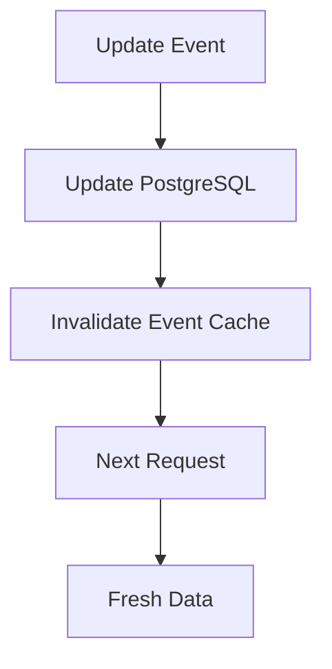

# 08_Caching

> For what the Calendar app actually implements, see the project-specific
> [Caching](caching.md) document. This file remains the original system-design
> exercise.

> Caching stores frequently accessed data temporarily so it can be retrieved faster without repeatedly accessing the primary database or another slower source.
> 

Basic flow:

```mermaid
User

↓

API

↓

Cache

├── Cache HIT → Return data

│

└── Cache MISS

↓

PostgreSQL

↓

Cache

↓

Response
```

## Why Use Caching?

Potential benefits:

- Reduced database load
- Faster responses
- Better scalability
- Reduced repeated queries

## Potential Calendar Use Cases

Potential candidates could include:

- Frequently accessed calendar data
- User preferences
- Public booking availability
- Frequently accessed configuration

However, calendar events can change frequently, so caching must account for stale data.

## Cache Invalidation

When data changes, cached data may need to be updated or removed.

Example:



## MVP Decision

Caching is currently a system-design consideration, not necessarily an MVP requirement.

The specific caching technology should be decided based on actual performance requirements.