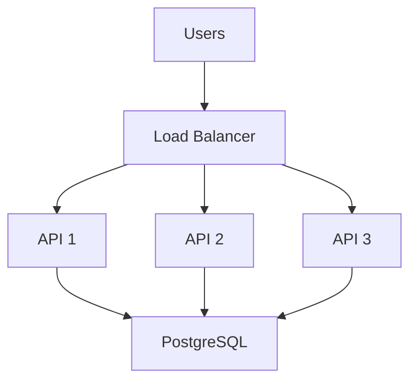
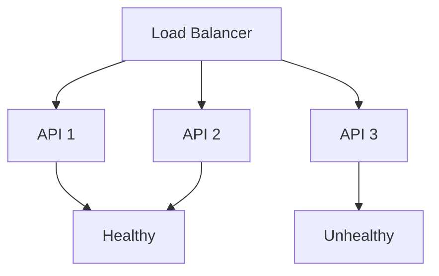

# 09_Load Balancing

> For the deployed Calendar app, see the project-specific
> [Load Balancing](load-balancing.md) document. This file remains the
> original system-design exercise.

Purpose

A load balancer distributes incoming requests across multiple backend instances.

## Why Use Load Balancing?

Potential benefits:

- Distribute traffic
- Improve availability
- Allow horizontal scaling
- Prevent one server from receiving all traffic

## Health Checks

A load balancer can check whether an application instance is healthy.

Traffic can then be directed away from unhealthy instances.

## MVP Decision

The MVP does not necessarily require multiple backend instances.

Load balancing is documented as a future scalability concept.