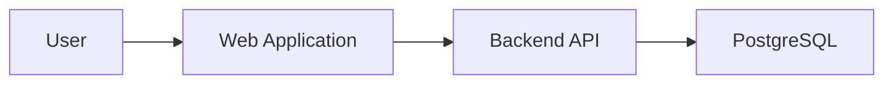
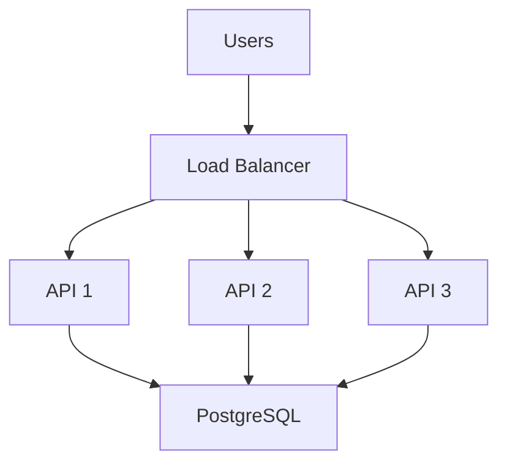

# 10_Scalability Strategy

## Initial Architecture

The MVP should prioritize simplicity.

## Future Scaling

As usage increases:

Additional scaling mechanisms could include:

- Horizontal scaling
- Caching
- Database optimization
- Indexing
- CDN
- Background processing

## Scaling Principle

Do not introduce infrastructure before there is a demonstrated requirement for it.