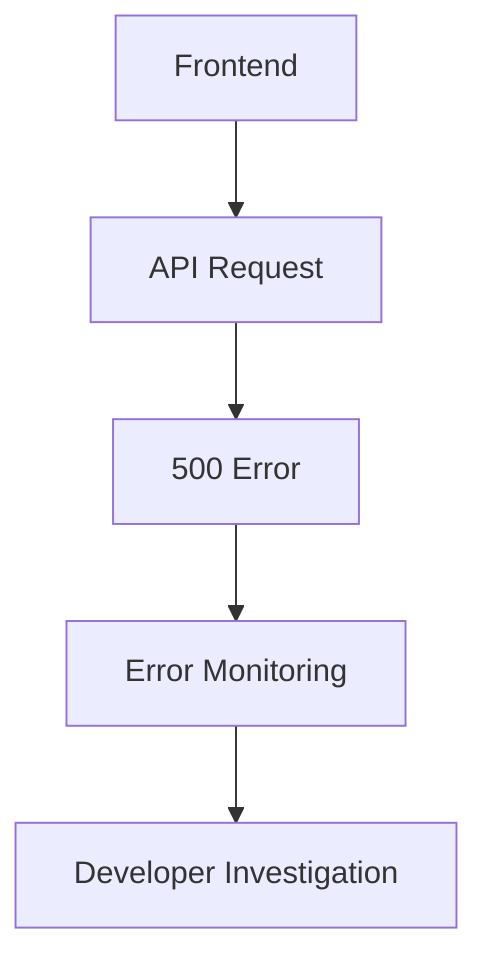

# 13_Observability

Purpose

Observability helps developers understand what is happening inside the production system.

Three important areas are:

- Logs
- Metrics
- Errors

## Logging

The backend should record useful operational information.

Example:

```
2026-10-01 09:32
POST /api/events
User: authenticated
Status: 201
Duration: 120ms
```

Sensitive information should not be unnecessarily logged.

## Error Monitoring

The system should capture unexpected application errors.

Example:



## Health Checks

A backend could expose a health endpoint:

GET /health

Example:

```jsx
{
"status": "healthy"
}
```

The exact monitoring platform is an open implementation decision.