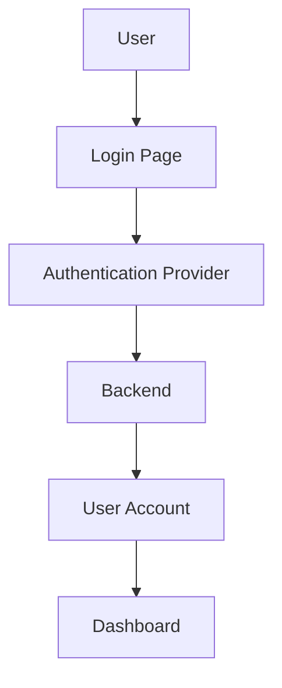
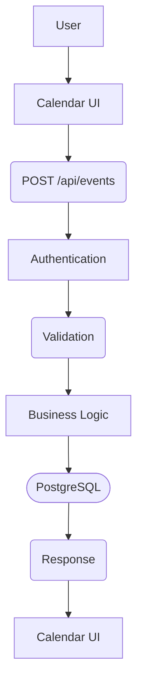
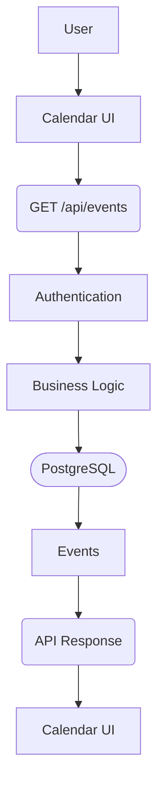

# 14_System Data Flows

This section documents how data moves through the system.

Login Flow



Create Event



Read Events



Update Event

```mermaid
User
 ↓
Edit Event
 ↓
PUT /api/events/:id
 ↓
Authentication
 ↓
Validation
 ↓
Business Logic
 ↓
PostgreSQL
 ↓
Updated Event
 ↓
Calendar UI
```

 Delete Event

```mermaid
User
 ↓
Delete Event
 ↓
DELETE /api/events/:id
 ↓
Authentication
 ↓
Authorization
 ↓
Business Logic
 ↓
PostgreSQL
 ↓
Confirmation
 ↓
Calendar UI
```