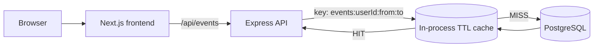
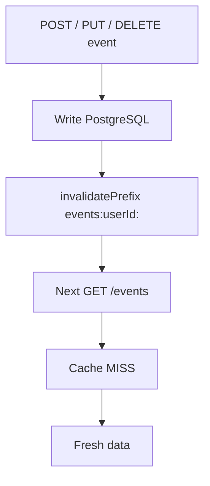
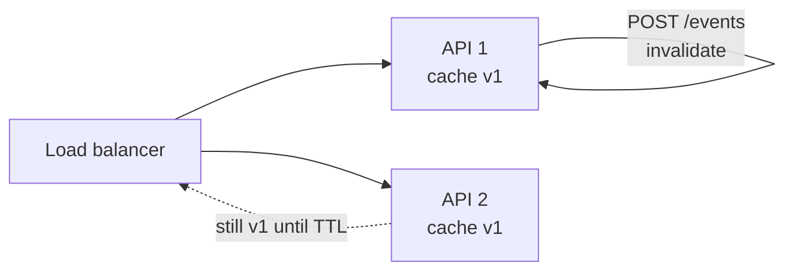

# Caching

How the Calendar app caches data, what is safe to cache, and where the
boundaries are. This document covers the caching that ships with the project;
the numbered [08_Caching](08_Caching%203dd1e9fd72968031bd66d7190fed4dcb.md) file
remains the original system-design exercise.

> **Production note:** no Redis service is required. Vercel and the browser
> cache static content, and the API adds a short-lived in-process cache for
> event windows. See [Shared caches](#shared-caches-and-multiple-instances) for
> when that stops being enough.

---

## Where caching happens

| Layer | What it caches | Configured by | Reuse scope |
| --- | --- | --- | --- |
| Next.js prerender + Vercel CDN | Landing page, auth pages, static assets | Build output | Everyone |
| Browser HTTP cache | Immutable `/_next/static/*` files | Next.js asset headers | One browser |
| API in-process cache | `GET /events` date windows | `backend/src/lib/cache.js` | One API instance |
| PostgreSQL / Neon pooler | Open database connections, not query results | pooled `DATABASE_URL` | One pool |

Connection pooling is sometimes mistaken for caching. It reuses TCP and
Postgres sessions; it never returns a previous query result. The only layer in
this project that stores API data is the in-process event cache.



---

## The event window cache

`backend/src/lib/cache.js` is a dependency-free TTL cache. `GET /events` uses it
like this:

1. Build the key from the authenticated user and the requested range:
   `events:<userId>:<from>:<to>`.
2. Return the cached array on a hit and set `X-Cache: HIT`.
3. On a miss, query Prisma, store the serialized payload, and set
   `X-Cache: MISS`.
4. Any create, update, or delete for that user removes every cached window that
   starts with `events:<userId>:`.

The cache key includes `req.userId`, never a value from the query string, so one
account can never be served another account's data.

Each response also carries:

```http
Cache-Control: private, no-store
X-Cache: HIT
```

`private, no-store` keeps browsers and shared proxies from storing authenticated
JSON. The server cache is the only layer allowed to reuse it.

### Invalidation



Deleting, creating, and updating all follow the same rule, so a write can never
leave a stale window on the instance that served it.

### Configuration

| Variable | Default | Purpose |
| --- | --- | --- |
| `EVENTS_CACHE_TTL_MS` | `5000` | How long an event window stays cached. `0` disables the cache. |
| `EVENTS_CACHE_MAX_ENTRIES` | `500` | Maximum cached windows per instance; the least recently used entry is evicted first. |

Restart the API after changing either value. In production, set them on the
backend Vercel project.

### Why only event lists?

- The calendar re-requests the same month or week whenever the user navigates
  back and forth, so repeated windows are a real hot path.
- Writes already have obvious invalidation points (`POST`, `PUT`, `DELETE`).
- `/auth/me` is a single indexed row read and drives the settings screen; a
  stale profile is more noticeable than it is valuable to cache.
- Password changes, session cookies, and anything under `/auth` are never
  cached.

---

## Shared caches and multiple instances

The cache lives in the API process. That is sufficient for local development
and for a single instance, but it has a deliberate limitation when several
instances run at once (for example `npm run cluster`, or several Vercel
Functions):

- A write invalidates the cache on the instance that handled the request.
- Other instances keep their own copies until the TTL expires.
- Staleness is therefore bounded by `EVENTS_CACHE_TTL_MS`, not eliminated.



Choose based on what the deployment needs:

| Requirement | Option |
| --- | --- |
| Local demos, single instance | Default 5 s TTL is enough. |
| Multiple instances, small staleness acceptable | Keep a short TTL, e.g. `2000`. |
| Strict read-after-write everywhere | Set `EVENTS_CACHE_TTL_MS=0` or add a shared cache. |
| Large scale, shared hot data | Move to Redis/Upstash with pub/sub invalidation. |

`EVENTS_CACHE_TTL_MS=0` is the safe switch: the middleware still runs, but
nothing is stored, so behaviour matches the pre-cache API.

If a shared cache is added later, keep the same key format and invalidation
points; only the store changes. The browser contract (`private, no-store`) and
the `X-Cache` header can stay the same.

---

## Memory and serverless behavior

- An entry is a list of events for one range. Memory stays bounded by
  `EVENTS_CACHE_MAX_ENTRIES`, and expired entries are dropped on read.
- Reads refresh recency, so the limit behaves like an LRU cache.
- On Vercel, each Function instance starts with an empty cache. Cold starts and
  scale-out simply miss; they never return wrong data.
- Restarting the API clears the cache. Nothing needs warming: the first request
  after a restart refills it.

---

## What must not be cached

| Data | Why |
| --- | --- |
| `Set-Cookie` / session JWTs | Caching a response would hand one user's session to another. |
| `/auth/login`, `/auth/signup`, `/auth/logout` | Credential and cookie side effects must run every time. |
| `/auth/password` | A cached success would hide a real password change. |
| Profile responses in a shared cache | Profile data is user-scoped and changes from settings. |
| Anything keyed only by URL | `/events?from=...` is per-user, even though the URL is identical for everyone. |

The one rule that covers all of them: authenticated responses are
`private, no-store` and may only be reused inside a per-user, per-instance
cache.

---

## Verify it

With the API running locally on `3001`:

```powershell
$email = "cache-test-$([DateTimeOffset]::UtcNow.ToUnixTimeMilliseconds())@example.com"
$session = New-Object Microsoft.PowerShell.Commands.WebRequestSession

Invoke-WebRequest -Uri http://localhost:3001/auth/signup -Method POST `
  -ContentType 'application/json' `
  -Body (@{ email = $email; password = 'password123' } | ConvertTo-Json) `
  -WebSession $session -UseBasicParsing | Out-Null

$range = 'from=2026-11-01&to=2026-11-30'

$first = Invoke-WebRequest -Uri "http://localhost:3001/events?$range" -WebSession $session -UseBasicParsing
$second = Invoke-WebRequest -Uri "http://localhost:3001/events?$range" -WebSession $session -UseBasicParsing

"first:  $($first.Headers['x-cache'])  $($first.Headers['cache-control'])"
"second: $($second.Headers['x-cache'])"
```

Expected:

```text
first:  MISS  private, no-store
second: HIT
```

Then create an event and read the same range again:

```powershell
Invoke-WebRequest -Uri http://localhost:3001/events -Method POST -WebSession $session `
  -ContentType 'application/json' `
  -Body (@{
    title = 'Cache check'; date = '2026-11-05'; startTime = '10:00'; endTime = '11:00'
    allDay = $false; color = 'blue'
  } | ConvertTo-Json) -UseBasicParsing | Out-Null

$after = Invoke-WebRequest -Uri "http://localhost:3001/events?$range" -WebSession $session -UseBasicParsing
"after write: $($after.Headers['x-cache'])"
```

Expected: `MISS`, and the response includes `Cache check`. Waiting longer than
the TTL and repeating the read also produces `MISS`.

Through the frontend proxy, the header is preserved end to end:

```powershell
(Invoke-WebRequest -Uri "http://localhost:3000/api/events?$range" -WebSession $session -UseBasicParsing).Headers['x-cache']
```

---

## Limitations

- Per-instance only; no cross-instance invalidation (bounded by the TTL).
- No request coalescing: several simultaneous misses for the same window all
  reach PostgreSQL.
- No compression, persistence, or cache warming.
- Only `GET /events` is cached; individual events, profiles, and settings are
  not.
- Counters live in memory and reset with the process.

For the wider picture, see [Load balancing](load-balancing.md) and the
[runnable local load balancer](load-balancer.md), which is the easiest way to
observe the per-instance behaviour described above.

---

## Related documentation

- [08_Caching](08_Caching%203dd1e9fd72968031bd66d7190fed4dcb.md) — the original
  system-design notes and MVP decision.
- [Load balancing](load-balancing.md) — traffic distribution and scaling phases.
- [Local load balancer](load-balancer.md) — run several instances and observe
  cache coherence.
- [Authentication API](README.md) — cookie and session contract.
