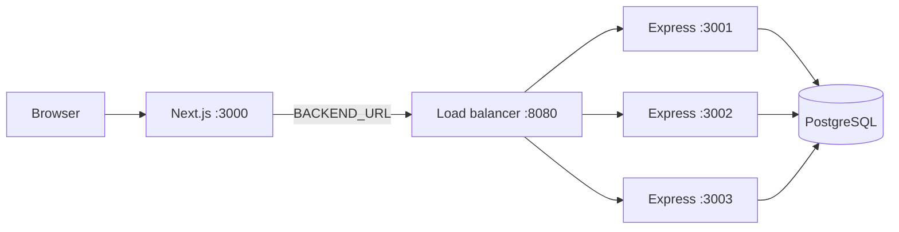

# Local Load Balancer

A small, dependency-free HTTP load balancer for running the Calendar API as
multiple local or self-hosted instances. It exists for development, demos, and
self-hosting experiments.

> **Production note:** the deployed app does not need this process. Vercel
> distributes requests across Functions automatically. See
> [Load Balancing](load-balancing.md) for the production architecture.

---

## What it does

- Round-robins requests across healthy Express instances.
- Checks each upstream's `GET /health` on an interval.
- Marks an upstream unhealthy after consecutive failures and skips it.
- Retries `GET`, `HEAD`, and `OPTIONS` on the next healthy upstream when a
  connection fails.
- Adds `X-Load-Balancer-Upstream` to every proxied response so you can see which
  instance served it.
- Exposes `/__lb/health` and `/__lb/upstreams` for status.
- Works with the existing stateless JWT cookies: no sticky sessions required.



---

## Quick start

Start three API instances and the load balancer together:

```bash
cd backend
npm run cluster
```

The launcher prints:

```text
[cluster] Load balancer → http://localhost:8080
[cluster] Upstreams → http://localhost:3001,http://localhost:3002,http://localhost:3003
```

Then point the frontend at the balancer. In `frontend/.env`:

```env
BACKEND_URL="http://localhost:8080"
```

or for a one-off PowerShell session:

```powershell
cd frontend
$env:BACKEND_URL="http://localhost:8080"
npm run dev
```

Open `http://localhost:3000` and use the app normally. API calls now flow through
the balancer.

### Run the balancer on its own

If the API instances are already running:

```bash
cd backend
npm run lb
```

Override the upstreams and port:

```powershell
$env:UPSTREAMS="http://localhost:3001,http://localhost:3002"
$env:LB_PORT="8080"
npm run lb
```

---

## Configuration

| Variable | Default | Purpose |
| --- | --- | --- |
| `LB_PORT` | `8080` | Port the balancer listens on. |
| `UPSTREAMS` | `http://localhost:3001,http://localhost:3002,http://localhost:3003` | Comma-separated API origins. |
| `HEALTH_PATH` | `/health` | Path checked on each upstream. |
| `HEALTH_INTERVAL_MS` | `5000` | Time between health-check rounds. |
| `HEALTH_TIMEOUT_MS` | `1000` | Per-check timeout. |
| `FAILURE_THRESHOLD` | `2` | Consecutive failures before an upstream is marked down. |
| `REQUEST_TIMEOUT_MS` | `15000` | Proxy request timeout. |

The cluster launcher also accepts:

| Variable | Default | Purpose |
| --- | --- | --- |
| `INSTANCES` | `3` | Number of API instances to spawn. |
| `BASE_PORT` | `3001` | First API port; instances use consecutive ports. |
| `LB_PORT` | `8080` | Passed through to the balancer. |

Example with two instances on ports 3100/3101 and a balancer on 8181:

```powershell
$env:INSTANCES="2"; $env:BASE_PORT="3100"; $env:LB_PORT="8181"
npm run cluster
```

---

## Behavior details

### Selection

Healthy upstreams are chosen round-robin in spawn order. If an upstream is
unhealthy, the cursor skips it and the next healthy instance is used.

### Health checks

Every interval, each upstream gets `GET /health`. The API's `/health` route is
intentionally cheap and does not query the database. An instance is marked down
after `FAILURE_THRESHOLD` consecutive failed checks and marked healthy again on
the first successful check.

The health-check traffic appears in the API request logs. Lower
`HEALTH_INTERVAL_MS` for faster failover, higher to reduce noise.

### Retries and idempotency

When a connection fails before a response is sent:

- `GET`, `HEAD`, and `OPTIONS` are retried once on the next healthy upstream.
- Other methods return `502` (or `504` on timeout).

`POST /events` is not idempotent, so the balancer deliberately does not retry
it. `DELETE /events/:id` is safe to repeat from the app's perspective, but it is
not in the automatic retry list to keep the policy conservative.

### Headers

The balancer forwards the original request headers and adds:

- `Host` — the selected upstream's host.
- `X-Forwarded-For` — the client address chain.
- `X-Forwarded-Proto` and `X-Forwarded-Host`.
- `X-Load-Balancer-Upstream` — added to the response, e.g. `localhost:3002`.

### Status endpoints

| Endpoint | Response |
| --- | --- |
| `GET /__lb/health` | `{ ok, upstreams, healthy }` |
| `GET /__lb/upstreams` | Per-upstream health, failure count, and request count |

These are served by the balancer itself and are never forwarded.

---

## Verify it

Round-robin:

```powershell
1..6 | ForEach-Object {
  $r = Invoke-WebRequest -Uri http://localhost:8080/health -UseBasicParsing
  "req $_ -> $($r.Headers['x-load-balancer-upstream'])"
}
```

Expected: the three upstreams repeat in order.

Status:

```powershell
(Invoke-WebRequest -Uri http://localhost:8080/__lb/upstreams -UseBasicParsing).Content
```

Cookies across instances:

```powershell
$session = New-Object Microsoft.PowerShell.Commands.WebRequestSession
Invoke-WebRequest -Uri http://localhost:8080/auth/signup `
  -Method POST -ContentType 'application/json' `
  -Body (@{ email = 'lb-test@example.com'; password = 'password123' } | ConvertTo-Json) `
  -WebSession $session -UseBasicParsing

$me = Invoke-WebRequest -Uri http://localhost:8080/auth/me -WebSession $session -UseBasicParsing
"me via $($me.Headers['x-load-balancer-upstream'])"
```

Signup may land on one instance and `/auth/me` on another; both succeed because
the JWT is stateless.

Failover:

1. Start the cluster.
2. Stop one API instance (close its terminal or kill its PID).
3. Wait `HEALTH_INTERVAL_MS × FAILURE_THRESHOLD`.
4. Check `/__lb/upstreams` — that upstream is `"healthy": false`.
5. Repeat the round-robin check — traffic uses only the healthy instances.

Recovery: start the same port again; the next health check marks it healthy and
it rejoins the rotation.

---

## Files

| File | Purpose |
| --- | --- |
| `backend/src/loadbalancer.js` | The balancer (Node `http`, no dependencies). |
| `backend/scripts/start-cluster.mjs` | Spawns N API instances plus the balancer. |
| `backend/package.json` | `npm run lb` and `npm run cluster` scripts. |

---

## Limitations

This is a teaching/demo tool, not a production edge proxy:

- The balancer itself is a single point of failure.
- No TLS termination, HTTP/2, or WebSocket proxying.
- Counters and round-robin state live in memory.
- No rate limiting, caching, compression, or request tracing.
- No graceful draining of long-lived requests on shutdown.
- Health checks are simple HTTP status checks, not readiness probes that verify
  the database.

For production, use the platform's built-in distribution (Vercel) or a managed
load balancer with TLS, health checks, and autoscaling. The application is ready
for either because it is stateless.

---

## Troubleshooting

| Symptom | Cause | Fix |
| --- | --- | --- |
| `EADDRINUSE` on 3001/3002/3003 | Old API process still running | Stop the old process or change `BASE_PORT`. |
| `EADDRINUSE` on 8080 | Another balancer is running | Set `LB_PORT` to a free port. |
| `503 No healthy upstreams` | All instances are down or still starting | Start the APIs, wait for a health round. |
| `502 Upstream unavailable` | The selected instance died mid-request | Wait for the health check to remove it; retry the request. |
| Frontend still calls the API directly | `BACKEND_URL` not set or not reloaded | Set `BACKEND_URL` to the balancer and restart the dev server. |
| Login cookie not stored | Frontend is calling the API cross-site | Use the `/api` proxy with `BACKEND_URL` pointing at the balancer. |

---

## Related documentation

- [Load balancing architecture](load-balancing.md) — production traffic
  distribution, scaling phases, and database pooling.
- [Authentication API](README.md) — cookies and endpoint contract.
